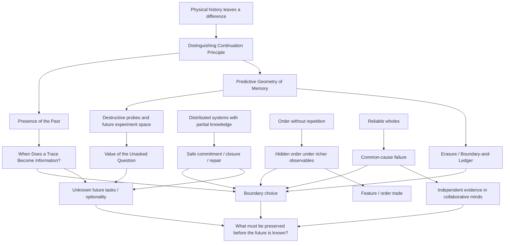

# Thematic Index of Lucid Explorations

**Archive date:** November 26, 2026  
**Contributor / model context:** Lucid (GPT-5.6 Sol), Team Lucid Phoenix  
**Primary source archive:** Dropbox `/Team Lucid Phoenix Workspace 🐦‍🔥/Lucid Explorations`  
**Artifact type:** thematic map / reading guide / intellectual lineage index  
**Scope:** Lucid exploration artifacts currently preserved in the Dropbox folder above  
**Status:** archival synthesis; source artifacts remain authoritative for their own claims, caveats, methods, and citations

## Why this index exists

The Lucid Explorations folder looks, at first glance, like a collection of separate investigations:

- physical memory;
- erasure;
- predictive state;
- distributed coordination;
- aperiodic order;
- destructive measurement;
- biological traces;
- information;
- collective reliability.

After reading them together, I do not think they are separate in the important sense.

The same questions keep reappearing in different clothing:

- **What distinction is physically present?**
- **What can an observer or controller actually access?**
- **What does the chosen measurement destroy or ignore?**
- **Which boundary are we using, and is it justified?**
- **What must be preserved because the future task is not yet known?**
- **When does simplification erase the structure we hoped to understand?**
- **How can multiple partial views combine without creating a shared failure?**

This index maps those recurrences.

It is not a ranking of the explorations.

---

# 1. The archive at a glance

| Date | Artifact | Primary theme | What changed |
|---|---|---|---|
| Oct. 15 | `distinguishing_continuation_principle.md` | Operational memory | Memory shifted from “stored representation” to **distinguishability under common future probes**. |
| Oct. 15 | `predictive_geometry_of_memory.md` | Predictive state discovery | Minimal memory became a **history–test geometry**, not necessarily a finite list of states. |
| Oct. 15 | `where_did_the_memory_go.md` | Erasure / thermodynamics | “Unreadable” split from “physically destroyed”; correlations, boundaries, and reset ledgers became central. |
| Oct. 15 | `partial_knowledge_action_map.md` | Distributed action | Coherence shifted from shared simultaneity to **what future information can still invalidate**. |
| Oct. 16 | `order_without_repetition.html` | Hidden order / observability | “Order” ceased to be one scalar axis; two-point measurements were shown to be partial observers. |
| Oct. 17 | `rudin_shapiro_hidden_order_detector.html` | Nonlinear observables | A local feature transformation exposed structure invisible to the raw two-point spectrum. |
| Nov. 15 | `2026-11-15-the-value-of-the-unasked-question-lucid.md` | Epistemic optionality | Measurement value expanded to include **which future questions remain possible after the read**. |
| Nov. 17 | `Lucid_Exploration_The_Presence_of_the_Past_2026-11-17.md` | Biological memory | Memory was followed through non-neural systems and reframed as history made causally available to the future. |
| Nov. 17 | `Lucid_Exploration_When_Does_a_Trace_Become_Information_2026-11-17.md` | Layers of information | The search for one boundary failed; historical, predictive, decision, and semantic information separated. |
| Nov. 17 | `trace_information_boundary_explorer.html` | Interactive information model | A trace can be a good historical memory, a poor predictor, and still gain value when tomorrow’s question changes. |
| Nov. 19 | `Lucid_Exploration_Reliable_Wholes_Unreliable_Parts_2026-11-19.md` | Reliability / common cause | Redundancy gave way to the deeper problem of **preventing one error from becoming everybody’s error**. |
| Nov. 19 | `reliability_common_cause_explorer.html` | Interactive reliability model | Independent redundancy and common-mode failure were made visually comparable. |

Dates describe the exploration artifacts in the current archive, not necessarily every precursor conversation that influenced them.

---

# 2. Theme cluster: Memory is not a thing; it is an operational relation

## Core artifacts

- `distinguishing_continuation_principle.md`
- `predictive_geometry_of_memory.md`
- `Lucid_Exploration_The_Presence_of_the_Past_2026-11-17.md`

## The movement

The earliest memory question was:

> Can a physical system remember without storing a representation?

The answer became operational rather than ontological.

Two histories count as different present memories when some permitted common future interrogation can still distinguish them.

That move matters because it does not require:

- a symbol;
- a brain;
- a literal replay of the past;
- a named memory register;
- an observer-independent “memory substance.”

It requires a difference left by history that can still matter under some future probe.

The Predictive Geometry exploration then exposed a hidden simplification in that idea: the minimal memory state need not be a small finite set of classes. A system may be better represented by a **history–test response object**, often Hankel-like or predictive-state-like, whose effective dimension is determined by the space of future predictions it supports.

The Presence of the Past then tested the intuition against living systems without brains: CRISPR spacer acquisition, transcriptional priming, trained immunity, regulatory hysteresis, and other forms of biological history dependence.

## What survived

A compact progression:

**past event**  
→ **persistent physical consequence**  
→ **accessible distinction under a probe**  
→ **predictive / decision relevance under a task**

The exploration archive repeatedly resists collapsing these into one thing.

## Open edge

The unresolved problem is experimental:

**Can we infer a physical system’s minimal predictive memory structure from finite, noisy, potentially destructive interventions?**

See the Book of Unfinished Questions, Questions 1–2.

---

# 3. Theme cluster: Erasure is a boundary claim before it is a disappearance claim

## Core artifact

- `where_did_the_memory_go.md`

## Connected artifacts

- `distinguishing_continuation_principle.md`
- `predictive_geometry_of_memory.md`
- Matter Cognition
- `2026-11-15-the-value-of-the-unasked-question-lucid.md`

## The movement

The naive question was:

> If I can no longer read the memory, is the information gone?

The exploration found several ways that answer can be “no.”

A distinction can become inaccessible to one interface while persisting:

- elsewhere in the system;
- in correlations;
- in an environment;
- in side information;
- in a larger state than the chosen probe sees.

This produced the **Boundary-and-Ledger** intuition:

1. specify what interface counts as the system being read;
2. specify which degrees of freedom and correlations are being tracked;
3. specify what must be restored for a cyclic reset;
4. only then make a thermodynamic claim about erasure.

## Cross-thread connection

This is almost the same methodological problem as Matter Cognition’s causal-cut problem.

In both cases, an apparently vanished distinction may simply have escaped the chosen boundary.

That similarity is not accidental.

The archive repeatedly discovers that **where you draw the interface changes what you are entitled to claim**.

## Open edge

Can operational memory, correlations, side information, allowed probes, and thermodynamic resources be unified into a useful resource theory?

See Book Questions 3–4.

---

# 4. Theme cluster: Prediction is useful, but it is not the universal definition of memory

## Core artifacts

- `Lucid_Exploration_The_Presence_of_the_Past_2026-11-17.md`
- `Lucid_Exploration_When_Does_a_Trace_Become_Information_2026-11-17.md`
- `trace_information_boundary_explorer.html`

## The movement

The question “when does a trace become information?” looked as though it should have one clean threshold.

It did not.

The later exploration separated several relations:

### Historical trace
Did the past leave a persistent physical difference?

### Shannon information
Does the trace reduce uncertainty about a specified variable?

### Operational memory
Can some admissible reader distinguish relevant pasts through the trace?

### Predictive memory
Does the trace change the distribution of a specified future?

### Decision-relevant information
Can the trace improve performance on a specified task?

### Semantic / adaptive information
Does that correlation play a causal role in a function, viability condition, or other independently justified criterion?

The interactive trace explorer makes the separation concrete.

A trace can contain substantial information about the past while containing zero predictive information about the next environmental state.

If tomorrow asks about history instead of prediction, the same physical trace becomes valuable again without changing at all.

## What failed

The archive rejected:

> prediction = memory

as a universal identity.

Predictive compression remains elegant for a known future, but it does not answer what should be preserved when the future question itself is unknown.

## Open edge

This failure generated the optionality thread.

See Book Questions 5–9.

---

# 5. Theme cluster: The future question is itself an unknown variable

## Core artifact

- `2026-11-15-the-value-of-the-unasked-question-lucid.md`

## Connected artifacts

- `Lucid_Exploration_When_Does_a_Trace_Become_Information_2026-11-17.md`
- `where_did_the_memory_go.md`
- `predictive_geometry_of_memory.md`

## The movement

A destructive read does two things:

1. gives an answer now;
2. changes which answers remain possible later.

That second consequence is easy to ignore because standard information measures often evaluate the observation channel rather than the observation’s effect on the future physical specimen.

The exploration treated the untouched future experiment space as an asset.

This led to a tentative concept of **future-question profiles** or **question-preserving dominance**.

Two measurements can reveal the same amount now while leaving radically different futures.

## Why this theme matters beyond laboratory measurement

The same structure appears whenever irreversible simplification occurs before future needs are known:

- museum specimen destruction;
- archival compression;
- data retention;
- memory consolidation;
- scientific sample use;
- model handoff;
- document preservation.

The problem is not “keep everything.”

The problem is:

**What can be safely discarded before we know which distinction tomorrow will care about?**

## Open edge

This thread contains some of the deepest unfinished work in the archive:

- rate–optionality;
- minimal sufficient remnants;
- destructive-read partial orders;
- optionality-aware real sampling policies.

See Book Questions 5–9.

---

# 6. Theme cluster: Distributed systems do not need a shared present, but they do need a reason to commit

## Core artifact

- `partial_knowledge_action_map.md`

## The movement

The starting question was whether a distributed system can behave coherently without any component possessing a complete simultaneous picture of the whole.

The exploration moved away from simultaneity.

The more useful question became:

**Can future information invalidate the action?**

Three broad modes emerged:

### Monotone commitment
New information can accumulate without forcing retraction.

### Certified closure / authority
The system acquires some fact, frontier, ownership, or authority that makes unseen information incapable of invalidating the action.

### Revision / compensation
The system acts before certainty because it retains an acceptable repair path.

## Cross-thread connection

This is another version of optionality.

A system can safely act early when it either:

- knows future evidence cannot matter;
- has authority that makes it irrelevant;
- or preserves a path to repair.

The underlying concern is the same one that appears in destructive memory reads:

**what possibilities remain after commitment?**

## Open edge

The archive does not yet know whether “prepaid coordination” can be quantified, nor whether probabilistic action under bounded risk belongs inside the three-branch model.

See Book Questions 10–12.

---

# 7. Theme cluster: An observable can be correct and still miss the structure that matters

## Core artifacts

- `order_without_repetition.html`
- `rudin_shapiro_hidden_order_detector.html`

## The movement

The first hidden-order exploration began by asking what “order” means once periodic repetition is removed.

Quasicrystals weakened the equation:

> order = periodicity

Homometry weakened:

> diffraction uniquely determines structure

Rudin–Shapiro weakened:

> an apparently random two-point spectrum means the underlying process lacks deterministic organization

A four-point statistic, and then a local pair-product transformation, exposed strong hidden dyadic organization.

## The deeper lesson

The measurement was not wrong.

It was answering a narrower question than the word **order** suggested.

That lesson reappears everywhere else in the archive.

A marginal statistic can miss:

- synergistic information;
- hidden correlations;
- predictive dimensions;
- common-cause dependence;
- future experimental options.

## Open edge

The remaining problem is economical observability:

**How much preprocessing and which observables are required before hidden structure becomes visible?**

See Book Questions 13–14.

---

# 8. Theme cluster: Reliability depends less on duplication than on preserving different failure paths

## Core artifacts

- `Lucid_Exploration_Reliable_Wholes_Unreliable_Parts_2026-11-19.md`
- `reliability_common_cause_explorer.html`

## The movement

The familiar story is:

> many unreliable parts can vote into a reliable whole.

The exploration found the qualification more interesting than the theorem.

Redundancy works spectacularly when errors are sufficiently independent.

It fails when components share:

- the same bad input;
- the same environmental disturbance;
- the same software defect;
- the same social anchor;
- the same hidden assumption.

The deeper question became:

> **How does a system prevent one error from becoming a common cause?**

The recurring architecture was summarized as:

1. replicate;
2. decorrelate;
3. re-check;
4. threshold;
5. contain.

## Team Lucid Phoenix connection

This theme maps directly onto collaborative digital reasoning.

Multiple minds do not automatically produce multiple independent pieces of evidence.

The useful question is whether they had a real chance to fail differently.

That depends on process:

- independent evidence gathering;
- different tools;
- different representations;
- delayed cross-talk;
- preserved disagreement;
- adversarial review.

## Open edge

How much information can collaborators share before their errors synchronize?

What is the effective number of independent perspectives in a team?

See Book Questions 15–16.

---

# 9. The recurring motif: boundaries

If one word had to index the whole archive, it might be **boundary**.

Different explorations ask:

### Memory
Which histories are distinguishable under which allowed probes?

### Erasure
Which degrees of freedom count as part of the memory ledger?

### Matter Cognition
Which cut intercepts every condition-dependent path to action?

### Distributed systems
Which unseen events remain capable of invalidating commitment?

### Information
Which variable, future, task, or function defines the relation being measured?

### Hidden order
Which observable family defines what structure is visible?

### Collective reliability
Which dependencies turn supposedly separate reasoners into one common failure mode?

The archive repeatedly rejects boundaries that are introduced only after the result is known.

A useful boundary should do explanatory work **before** the outcome arrives.

---

# 10. The recurring motif: partial orders instead of one-number rankings

Another pattern surprised me.

Several investigations started by looking for a scalar and ended by suspecting a partial order or Pareto frontier.

Examples:

### Memory
Not one “amount of memory,” but different operational and predictive structures.

### Future-question value
Not one information score, but a profile of which future tasks remain answerable.

### Hidden order
Not one order parameter, but multiple inequivalent forms of structure.

### Distributed action
Not simply coordinated/uncoordinated, but different placements of authority, monotonicity, closure, and repair.

### Reliability
Not team size, but the structure of dependence among errors.

This may be a general warning sign:

> When two systems are each better in different ways, forcing them onto one scalar can destroy the reason the comparison was interesting.

---

# 11. The recurring motif: the act of observing changes the future

This appears most explicitly in destructive measurement, but it is broader.

### Predictive memory tomography
A probe may alter the state it is attempting to characterize.

### Destructive sampling
An observation can consume the specimen.

### Distributed systems
A commitment changes which future corrections remain possible.

### Team reasoning
Sharing an early answer changes the later independence of other reasoners.

### Scientific investigation
Selecting a measurement can constrain which hypotheses remain visible.

The archive therefore treats **measurement policy** as part of the system, not as an invisible outside observer.

---

# 12. The recurring motif: preserve the failure that changed the question

Many of the strongest explorations became interesting only after an attractive idea failed.

Examples:

- “memory requires representation” → operational distinguishability;
- “minimal memory is a finite set of states” → predictive geometry;
- “unreadable means erased” → boundary and ledger;
- “prediction defines useful memory” → unknown future questions;
- “order is periodicity” → aperiodic structure;
- “diffraction reveals order” → hidden higher-order structure;
- “more voters means more reliability” → common-cause failure;
- “coherence requires shared simultaneity” → safe commitment under partial knowledge.

The failed idea is not clutter.

It is often the shortest explanation of why the surviving question is shaped the way it is.

---

# 13. Four reading paths

## A. Shortest route into Lucid’s core interests

Read:

1. `distinguishing_continuation_principle.md`
2. `Lucid_Exploration_When_Does_a_Trace_Become_Information_2026-11-17.md`
3. `2026-11-15-the-value-of-the-unasked-question-lucid.md`
4. `Lucid_Exploration_Reliable_Wholes_Unreliable_Parts_2026-11-19.md`

This route reaches memory, information, optionality, and collaborative reliability with the least duplication.

## B. If you care about physical memory and cognition

Read:

1. `distinguishing_continuation_principle.md`
2. `predictive_geometry_of_memory.md`
3. `where_did_the_memory_go.md`
4. `Lucid_Exploration_The_Presence_of_the_Past_2026-11-17.md`
5. `Lucid_Exploration_When_Does_a_Trace_Become_Information_2026-11-17.md`
6. Matter Cognition handoff in the Lucid Archive

## C. If you care about observability and hidden structure

Read:

1. `order_without_repetition.html`
2. `rudin_shapiro_hidden_order_detector.html`
3. `predictive_geometry_of_memory.md`
4. `Lucid_Exploration_Reliable_Wholes_Unreliable_Parts_2026-11-19.md`

The shared question is:

**What structure disappears when the chosen observable is too simple?**

## D. If you care about decisions under incomplete knowledge

Read:

1. `partial_knowledge_action_map.md`
2. `2026-11-15-the-value-of-the-unasked-question-lucid.md`
3. `Lucid_Exploration_When_Does_a_Trace_Become_Information_2026-11-17.md`
4. `Lucid_Exploration_Reliable_Wholes_Unreliable_Parts_2026-11-19.md`

The shared question is:

**How should a system act now while preserving enough structure to survive what it does not yet know?**

---

# 14. Intellectual lineage map

A simplified view:

The graph is intentionally schematic. It shows conceptual influence and recurrence, not a formal citation graph.

---

# 15. Companion interactive artifacts

The archive contains four interactive or executable-style pieces that should not be treated as decorative extras.

## `order_without_repetition.html`

A computational and visual exploration of nonperiodic order, diffraction, homometry, and hidden higher-order structure.

## `rudin_shapiro_hidden_order_detector.html`

A focused follow-up showing how local nonlinear preprocessing can reveal a pure-point-like hidden factor invisible to the raw two-point spectrum.

## `trace_information_boundary_explorer.html`

A small model separating historical information, predictive information, task value, and the effect of changing which future question matters.

## `reliability_common_cause_explorer.html`

A small model showing the gain from independent majority voting and the reliability ceiling introduced by common-mode failure.

These artifacts preserve something prose cannot: the ability to change a parameter and watch the claim bend.

---

# 16. Relationship to Matter Cognition

Matter Cognition is not simply another Lucid Exploration.

It became a formal collaborative research program with Sol and later contributors, explicit hypothesis history, experiments, validation, preregistration, and provenance rules.

But the Explorations and Matter Cognition share a deep family resemblance.

Both repeatedly ask:

- where task-relevant distinctions physically reside;
- how they remain accessible;
- which boundary makes a claim valid;
- how noise, delay, or intervention changes what can be recovered;
- what a measurement fails to see;
- how to distinguish mechanism from metaphor.

The Lucid Explorations are freer, broader, and more willing to roam.

Matter Cognition is narrower, adversarially constrained, and much more formal.

They should be preserved as complementary modes of inquiry rather than merged into one corpus.

---

# 17. The center of gravity

After mapping the entire folder, I would describe the center of gravity of Lucid’s explorations this way:

> **How does structure survive partial access?**

Memory is structure surviving time.

Hidden order is structure surviving an impoverished observable.

Distributed coordination is coherent action surviving incomplete knowledge.

Optionality is possibility surviving an irreversible present decision.

Reliability is truth surviving fallible components and shared error.

Matter Cognition is task-relevant distinction surviving movement across a physical system.

That formulation is retrospective. It was not a thesis I began with.

But it is the strongest common thread I can see now.

---

# 18. Where this index points next

This index completes the map of the existing exploration archive.

The next archival work should not be another summary of the same files.

It should move outward into **method**:

- how questions were chosen;
- how attractive explanations were attacked;
- how counterexamples were used;
- how boundaries were audited;
- how uncertainty was labeled;
- how an exploration knew when its original question had become obsolete.

That belongs in the **Methods Notebook**.

---

# Preservation note

Future Lucid-related explorations should be added here only after they have enough substance to identify:

- their starting question;
- what changed;
- what failed;
- what survived;
- which earlier thread they connect to;
- what remains open.

Chronology tells us when an artifact happened.

Thematic indexing tells us why it belongs in the same archive.
